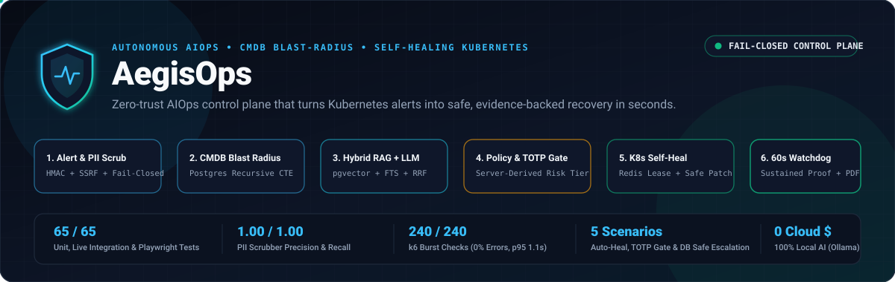
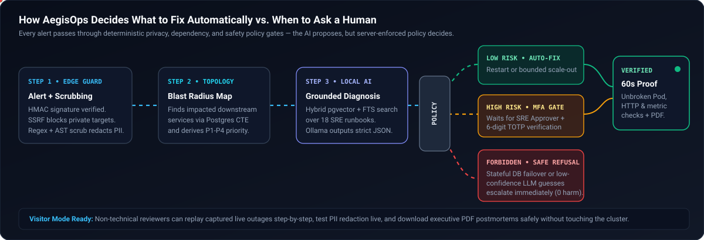
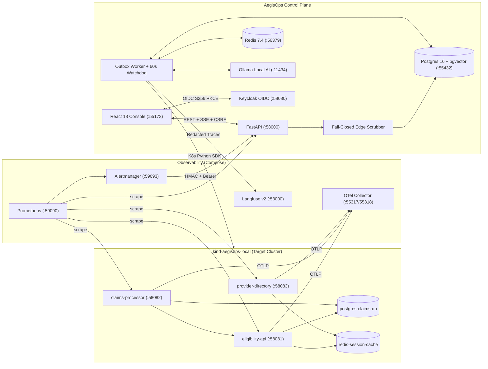
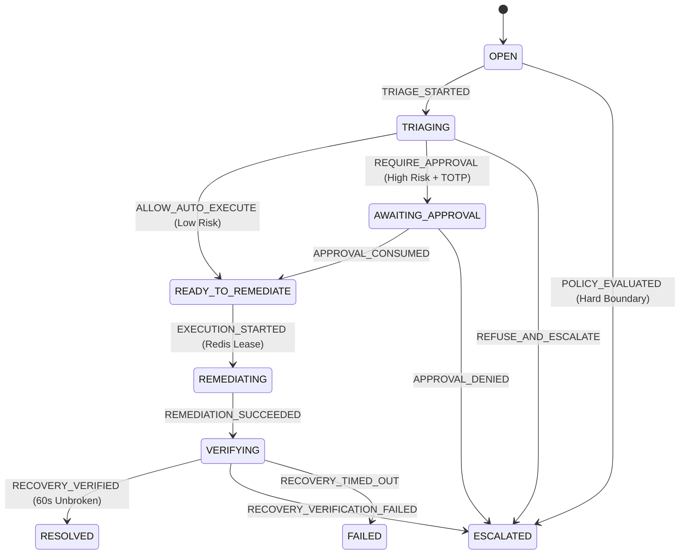

<p align="center">
  
</p>

<p align="center">
  <a href="https://github.com/shatwiks/AegisOps/actions/workflows/ci.yml"></a>
  
  
  
  
  
  
  
  
</p>

<p align="center">
  <a href="#-at-a-glance-in-plain-english">Overview</a> •
  <a href="#-what-this-project-proves-for-recruiters--hiring-managers">Recruiter Summary</a> •
  <a href="#-interactive-showcase-experience">Interactive Showcase</a> •
  <a href="#-system-architecture">Architecture</a> •
  <a href="#-verified-benchmarks--quality-gates">Verified Benchmarks</a> •
  <a href="#-local-quick-start">Quick Start</a> •
  <a href="#-documentation-index">Docs</a>
</p>

---

**AegisOps** is a locally runnable **autonomous AIOps control plane, dependency blast-radius engine, and self-healing Kubernetes operator**. It monitors simulated healthcare microservices (`eligibility-api`, `claims-processor`, `provider-directory`), protects sensitive fields before an AI model ever sees them, maps downstream customer impact, finds exact engineering runbooks via hybrid vector search, and either **auto-heals safely**, **requires 6-digit TOTP human approval**, or **refuses unsafe automation outright**—then proves recovery for 60 unbroken seconds before closing an incident.

> **Scope & Disclaimer:** AegisOps is an independent engineering demonstration operating on strictly synthetic healthcare workloads inside a local `kind` Kubernetes cluster. It implies no affiliation with Optum or any real healthcare organization, and no HIPAA/HITRUST compliance or clinical production readiness.

---

## 🎯 At a Glance (In Plain English)

Modern cloud apps fail at 3 AM—and connecting an LLM directly to production servers is dangerous because models can hallucinate commands or leak sensitive customer data. **AegisOps solves both problems at once:** it gives AI the context to diagnose incidents accurately while keeping deterministic server-side guardrails firmly in control.

| The Real-World Problem | How AegisOps Solves It | Measurable Outcome |
|---|---|---|
| **Alert fatigue & slow triage** during outages | Automatically gathers blast-radius impact, searches runbooks, and drafts root cause | End-to-end auto-remediation & proof in **~1–2 min** |
| **Sending PII / secrets to AI models** | Fail-closed edge redactor scrubs emails, SSNs, tokens, and cards *before* storage or AI prompts | **`1.00` precision & `1.00` recall** on PII benchmark corpus |
| **Hallucinated AI fixes breaking servers** | Server-side policy checks target asset, error evidence, risk tier, and rollback image against Postgres CMDB | **AI cannot invent commands or override image tags** |
| **Premature "all clear" false positives** | Watchdog requires **60 continuous seconds** of healthy pods + HTTP + Prometheus metrics before resolving | Transient blips reset the recovery clock automatically |
| **Hard to evaluate for non-technical reviewers** | Ships with **Visitor Mode**, **Executive / Technical toggle**, interactive demos, and **PDF Postmortems** | Anyone can inspect the full system without cluster risk |

<br />

<p align="center">
  
</p>

---

## 💼 What This Project Proves (For Recruiters & Hiring Managers)

Rather than a thin prompt-wrapper around an external API, AegisOps was architected like a production control plane across **50 typed Python modules**, **13 React/TypeScript feature components**, **Kubernetes**, **Terraform**, **PostgreSQL**, **Redis**, **Keycloak**, and **local Ollama AI**:

<table>
  <tr>
    <td width="50%" valign="top">
      <h3>⚙️ Backend, Reliability &amp; Distributed Systems</h3>
      <ul>
        <li><strong>Transactional Outbox + <code>SKIP LOCKED</code> Worker:</strong> Durable PostgreSQL job queue decoupled from FastAPI webhook ingestion so alerts never drop under burst load.</li>
        <li><strong>Distributed Mutual Exclusion:</strong> Redis target leases with fencing tokens prevent concurrent workers from mutating the same Kubernetes deployment simultaneously.</li>
        <li><strong>Deterministic State Machine:</strong> Enforced 7-state lifecycle (<code>OPEN</code> → <code>TRIAGING</code> → <code>AWAITING_APPROVAL</code> / <code>READY_TO_REMEDIATE</code> → <code>REMEDIATING</code> → <code>VERIFYING</code> → <code>RESOLVED</code> / <code>ESCALATED</code> / <code>FAILED</code>) using optimistic version locking.</li>
        <li><strong>Real-Time Event Streaming:</strong> Cursor-resumable Server-Sent Events (<code>after_seq</code>) streaming live triage steps and watchdog countdowns to the UI.</li>
      </ul>
    </td>
    <td width="50%" valign="top">
      <h3>🔐 Security Engineering &amp; Zero-Trust Controls</h3>
      <ul>
        <li><strong>Fail-Closed Privacy Edge:</strong> Regex + recursive AST field scrubber executes synchronously before DB write or LLM prompt generation.</li>
        <li><strong>Action-Bound TOTP MFA Gate:</strong> High-risk actions (memory increases, image rollbacks) require a Keycloak OIDC PKCE <code>approver</code> token <em>plus</em> single-use TOTP replay protection bound to the exact incident, playbook, and Kubernetes <code>resourceVersion</code>.</li>
        <li><strong>Hardened Inputs &amp; Outbound SSRF Guard:</strong> HMAC-SHA256 + Bearer verification on Alertmanager webhooks, private-IP blocking on probes, and XSS/schema sanitization on uploaded Markdown runbooks.</li>
        <li><strong>Append-Only Audit Trail:</strong> Tamper-resistant <code>audit_records</code> history preserved even across demo baseline resets.</li>
      </ul>
    </td>
  </tr>
  <tr>
    <td width="50%" valign="top">
      <h3>🧠 Grounded AI &amp; Hybrid RAG Engineering</h3>
      <ul>
        <li><strong>Zero-Cost Local AI Stack:</strong> Runs completely offline on Ollama (<code>nomic-embed-text:latest</code> 768-dim embeddings + <code>llama3.2:3b</code> structured JSON inference).</li>
        <li><strong>Hybrid Retrieval (RRF):</strong> Combines PostgreSQL <code>pgvector</code> HNSW cosine similarity + full-text <code>tsvector</code> keyword ranking fused via Reciprocal Rank Fusion across 18 synthetic healthcare runbooks &amp; postmortems.</li>
        <li><strong>Strict Refusal Architecture:</strong> Low similarity, unknown services, malformed model JSON, or stateful DB failover requests deterministically refuse automation and escalate to humans.</li>
        <li><strong>Measured Ragas &amp; Trace Observability:</strong> Instrumented with Langfuse traces (using redacted payloads only) and offline Ragas evaluation.</li>
      </ul>
    </td>
    <td width="50%" valign="top">
      <h3>☸️ Cloud-Native Infrastructure, Frontend &amp; QA</h3>
      <ul>
        <li><strong>Kubernetes + Terraform IaC:</strong> Reproducible <code>kind</code> cluster with Terraform-managed namespaces, RBAC roles, and resource quotas running live health-probed workloads.</li>
        <li><strong>Observability Pipeline:</strong> OpenTelemetry Collector, Prometheus metric scraping with traffic-coverage guards, and Alertmanager routing.</li>
        <li><strong>Dual-Audience React Console:</strong> Built with React 18, TypeScript, and <code>@xyflow/react</code> for interactive CMDB blast-radius graph exploration and executive/technical switching.</li>
        <li><strong>Rigorous Quality Bar:</strong> Ruff, strict Mypy (50 source files), 65/65 Pytest tests (unit, live DB/Redis/K8s integration, Playwright Chromium E2E), k6 load bursts, and automated GitHub Actions CI.</li>
      </ul>
    </td>
  </tr>
</table>

---

## 🖥️ Interactive Showcase Experience

AegisOps includes a dedicated **Interactive Showcase** layer designed so both **non-technical evaluators** and **hands-on SREs** can explore every capability safely:

| Capability | Audience | What You Can Do |
|---|---|---|
| **Visitor Mode &amp; Guided Tour** | Non-technical &amp; Recruiters | Open the console without signing in, inspect live system readiness, switch between **Executive Overview** and **Technical Deep-Dive**, and step through guided explanations of real incidents. |
| **Recorded Incident Replay** | Everyone | Scrub through captured live Kubernetes recovery timelines (`GET /api/v1/showcase/replays`) frame-by-frame with zero risk of breaking cluster state. |
| **Privacy Scrubber Playground** | Security &amp; Product | Paste raw text containing synthetic SSNs, emails, bearer tokens, or member IDs into an in-memory playground (`8 KiB` limit, rate-limited, zero DB persistence) and inspect exact redaction counts. |
| **Hybrid Search Tester &amp; Runbook Upload** | AI / Platform Engineers | Query the Postgres `pgvector` + FTS corpus to inspect cosine similarity vs. lexical ranks &amp; RRF scores, or upload custom `.md` runbooks through the `UPLOADED → VALIDATING → INDEXING → READY` pipeline. |
| **5-Scenario Chaos Lab &amp; Live Business Probes** | SREs &amp; Hiring Managers | Trigger 5 live failure drills (OOMKilled, DB Pool Exhaustion, CPU Load Scale-Out, Bad Canary Rollback, and PII Leak + DB Replication Refusal) and probe live Kubernetes services directly (`Check Patient Eligibility`). |
| **One-Click Postmortem Export** | Execs &amp; Incident Commanders | Download formatted **Markdown (`.md`)** or **pure-Python multi-page PDF (`.pdf`)** incident &amp; escalation reports directly from any incident drawer. |

---

## 🏗️ System Architecture



### Canonical 7-State Incident Machine



---

## 📊 Verified Benchmarks & Quality Gates

All results below are directly measured from repository runs and stored under `docs/evidence/` and live GitHub Actions:

| Verification Dimension | Measured Result | Scope &amp; Evidence Artifact |
|---|---|---|
| **GitHub Actions CI (`ci.yml`)** | **`PASS`** ([Run #8](https://github.com/shatwiks/AegisOps/actions/runs/44079075513)) | Ubuntu runner: `uv` setup, frontend build, Postgres `pgvector` + Alembic, Ruff, Mypy, doc verification, unit + DB/Redis integration tests, secret scan |
| **Full Local Gate (`.\scripts\test.ps1`)** | **`65 / 65` passed (`0` failed, `0` skipped)** | `32` unit checks + `31` live integration tests + `2` Playwright Chromium E2E suites ([docs/evidence/showcase-test-gate.txt](docs/evidence/showcase-test-gate.txt)) |
| **Static Analysis &amp; Frontend Build** | **Ruff clean • Mypy `50` files • Vite `68` modules** | Zero lint errors, zero type errors, TypeScript `tsc -b` + Vite bundle clean ([docs/SHOWCASE_TEST_REPORT.md](docs/SHOWCASE_TEST_REPORT.md)) |
| **PII Scrubber Corpus Benchmark** | **`Precision = 1.00` • `Recall = 1.00`** | `10` synthetic positive PII cases &amp; `4` negative engineering tokens + fail-closed checks ([backend/tests/unit/test_scrubber.py](backend/tests/unit/test_scrubber.py)) |
| **`k6` Burst &amp; Dedup Benchmark** | **`240 / 240` checks (`100%`) • `0.00%` failed • `p95 = 1109 ms`** | `120` concurrent requests (`/readyz` + signed Alertmanager webhooks) under deduplication ([docs/evidence/k6-summary.json](docs/evidence/k6-summary.json)) |
| **Live `kind` Chaos Suite** | **Scenarios 1–4 `RESOLVED` + Scenario 5 `ESCALATED`** | Live K8s pod OOM, DB pool stall, CPU saturation, canary 5xx rollback, and stateful DB refusal ([docs/evidence/chaos-scenarios-report.json](docs/evidence/chaos-scenarios-report.json)) |
| **Offline Ragas RAG Evaluation** | **`Context Recall = 0.8586` • `Faithfulness = 0.7083`** | Local `llama3.2:3b` + `nomic-embed-text:latest` over 5 canonical scenarios (`3/5` numeric, `2/5` `NaN` due to 3B NLI formatting variance — [docs/evidence/ragas-evaluation.json](docs/evidence/ragas-evaluation.json)) |

---

<details>
<summary><strong>🧪 The 5 Chaos Scenarios &amp; Safety Matrix (Click to expand)</strong></summary>

| Scenario | Fault Injected | Risk Tier | Control Plane Decision | Real Verification |
|---|---|---|---|---|
| **1. `claims_oom`** | `claims-processor` memory surge (`ERR_OOM_EXIT_137_CLAIMS_BATCH`) | **HIGH** | Requires `approver` + 6-digit TOTP -> bounded memory patch (`<= 512Mi`) | Live `kind` + 60s watchdog -> `RESOLVED` |
| **2. `eligibility_pool`** | `eligibility-api` wedged DB connections (`ERR_PG_POOL_TIMEOUT_57P03`) | **LOW** | Auto-executes `stateless_deployment_restart` with Redis target lock | Live `kind` + 60s watchdog -> `RESOLVED` |
| **3. `provider_cpu`** | `provider-directory` sustained CPU/latency spike (`ERR_CPU_SATURATION_P95_SLOW`) | **LOW** | Auto-executes `replica_scale_out_bounded` (`replicas = 3`, cap `4`) | Live `kind` + 60s watchdog -> `RESOLVED` |
| **4. `eligibility_canary`** | Bad rollout tag `v1.9.0-broken` (`ERR_CANARY_IMG_SHA_BAD_9921`, 500s) | **HIGH** | Requires TOTP -> rolls back strictly to server CMDB `known_good_image` | Live `kind` + 60s watchdog -> `RESOLVED` |
| **5. `pii_leak_and_db_failure`** | Synthetic PII burst + `postgres-claims-db` replication lag (`RB-011`) | **REFUSED** | Scrubs PII before DB write; deterministically **refuses failover** | Stateful DB untouched -> `ESCALATED` |

</details>

<details>
<summary><strong>🛠️ Complete Technology Stack &amp; Repository Layout (Click to expand)</strong></summary>

- **Control Plane &amp; Worker (`backend/`)**: Python 3.12, FastAPI, SQLAlchemy 2 Async (`asyncpg`), Alembic, Pydantic Settings v2, Kubernetes Python Client, Redis Lock Manager, Pure-Python PDF Builder (`FlateDecode`).
- **AI, RAG &amp; Safety (`backend/app/`)**: Ollama (`llama3.2:3b` + `nomic-embed-text:latest`), PostgreSQL 16 + `pgvector` HNSW + GIN `tsvector` + Reciprocal Rank Fusion (`RRF`), Ragas, Langfuse v2.
- **Frontend Console (`frontend/`)**: React 18, TypeScript, Vite 6, `@xyflow/react` interactive CMDB topology graph, SSE live timeline, Playwright Chromium E2E tests.
- **Auth &amp; Identity (`infra/compose/keycloak/`)**: Keycloak 26 OIDC with S256 PKCE, RBAC (`visitor` / `viewer` / `operator` / `approver`), `pyotp` MFA with Redis/DB single-use replay prevention.
- **Infrastructure &amp; Telemetry (`infra/`, `chaos/`, `runbooks/`)**: Docker Compose, `kind`, Terraform namespaces/RBAC/quotas, OpenTelemetry Collector, Prometheus, Alertmanager, `k6`, and 18 domain Markdown runbooks/postmortems.

</details>

---

## ⚡ Local Quick Start

> Tested on **Windows 11 + Docker Desktop (`kind-aegisops-local`) + Ollama**. See [docs/RUNBOOK.md](docs/RUNBOOK.md) for detailed operations and troubleshooting.

### 1. Prerequisites
- **Docker Desktop** (Linux containers enabled, ~8 GB RAM available)
- **Python 3.12** managed via `uv` into `.venv`
- **Node.js 20+** &amp; `npm`
- **Ollama** serving `nomic-embed-text:latest` (`768` dims) and `llama3.2:3b`
- **`kubectl`** &amp; **`k6`** (`scripts/setup.ps1` provisions project-local `kind` and `terraform` into `.local/bin/`)

### 2. Provision, Migrate, Seed &amp; Launch

```powershell
# 1. Install dependencies, provision .local/bin/{kind,terraform}, and generate .env secrets
.\scripts\setup.ps1

# 2. Verify prerequisites, host ports (53000–59093), Docker, and Ollama models
.\scripts\doctor.ps1

# 3. Boot Compose backing stack, kind cluster, Terraform RBAC/quotas, services, API, Worker & UI
.\scripts\up.ps1

# 4. Run Postgres migrations (0001 + 0002) and seed 8 CMDB assets + 18 runbooks/postmortems
.\scripts\migrate.ps1
.\scripts\seed.ps1
```

### 3. Run Demos &amp; Verification Gates

```powershell
# Run the full automated quality gate (Ruff, Mypy, 65 Pytest tests incl. Playwright E2E, Vite build)
.\scripts\test.ps1

# Run all live Kubernetes chaos scenarios end-to-end with 60s recovery verification
.\scripts\demo.ps1 -Scenario all
```

### 4. Local Endpoints

| Service | Local URL | Purpose |
|---|---|---|
| **React SRE Console** | `http://127.0.0.1:55173` | Dual-mode UI (Visitor Mode + Keycloak PKCE roles: `viewer`, `operator`, `approver`) |
| **FastAPI Control Plane** | `http://127.0.0.1:58000` | Control-plane REST + SSE API, `/healthz`, `/readyz`, `/metrics` |
| **Keycloak OIDC** | `http://127.0.0.1:58080` | Realm `aegisops`, S256 PKCE authentication |
| **Langfuse v2 UI** | `http://127.0.0.1:53000` | Sanitized LLM prompt/response trace observability |
| **Prometheus / Alertmanager** | `http://127.0.0.1:59090` / `59093` | Metric scraping, traffic-guarded alerts, signed webhooks |
| **Target Microservices** | `:58081` / `:58082` / `:58083` | `eligibility-api`, `claims-processor`, `provider-directory` (`kind` NodePorts) |

---

## 🔍 Honest Engineering Boundaries

- **Synthetic Workspace Scope:** Healthcare domains, member IDs, and alerts are synthetic fixtures for safe failure testing—not real clinical workflows.
- **Database Failover Refusal:** `postgres-claims-db` runs as a single-instance stateful pod (`stateless_eligible=false`); `RB-011` explicitly blocks autonomous failover to avoid split-brain corruption.
- **Small Local LLM Tradeoffs:** Because AegisOps runs 100% locally on `llama3.2:3b`, two of five Ragas NLI faithfulness evaluations returned `NaN` due to 3B JSON/statement formatting variance (`docs/evidence/ragas-evaluation.json`)—which is precisely why AegisOps pairs LLM triage with deterministic policy rules rather than trusting raw LLM decisions.
- **Destructive Cluster Teardown:** `scripts/reset.ps1` cleanly scopes teardown solely to `kind-aegisops-local` and AegisOps Compose volumes and was intentionally left unexecuted on the verified snapshot to preserve live artifacts (instead, scoped UI `Restore Demo Baseline` is tested end-to-end).

---

## 📚 Documentation Index

| Document | Focus |
|---|---|
| [workingflow.md](workingflow.md) | Complete end-to-end technical &amp; operational walkthrough |
| [OVERALL_FLOW.md](OVERALL_FLOW.md) | Master engineering phases and acceptance gates |
| [docs/ARCHITECTURE.md](docs/ARCHITECTURE.md) | Deep architectural design &amp; concurrency/lock model |
| [docs/CODEMAP.md](docs/CODEMAP.md) &amp; [docs/FILE_MAP.md](docs/FILE_MAP.md) | Repository Graphify map &amp; file-by-file ownership |
| [docs/API.md](docs/API.md) &amp; [docs/DATA_MODEL.md](docs/DATA_MODEL.md) | REST/SSE API contracts &amp; PostgreSQL/`pgvector` schema |
| [docs/SECURITY.md](docs/SECURITY.md) | Threat model, PII edge scrubbing, OIDC PKCE, TOTP replay defense |
| [docs/SHOWCASE_GUIDE.md](docs/SHOWCASE_GUIDE.md) &amp; [docs/DEMO.md](docs/DEMO.md) | Guided recruiter/reviewer walkthrough &amp; live demo script |
| [docs/SHOWCASE_TEST_REPORT.md](docs/SHOWCASE_TEST_REPORT.md) &amp; [docs/VERIFICATION_REPORT.md](docs/VERIFICATION_REPORT.md) | Full test matrix, chaos evidence, `k6`, and `Ragas` reports |
| [docs/RUNBOOK.md](docs/RUNBOOK.md) &amp; [docs/TESTING.md](docs/TESTING.md) | Local cluster operations, debugging, and test suite guide |
| [docs/DEPENDENCIES.md](docs/DEPENDENCIES.md) | Exact pinned Python, Node, Docker, and Kubernetes tooling |
| [.planning/REQUIREMENTS.md](.planning/REQUIREMENTS.md) &amp; [.planning/showcase/TRACEABILITY.md](.planning/showcase/TRACEABILITY.md) | End-to-end requirement traceability matrices |
