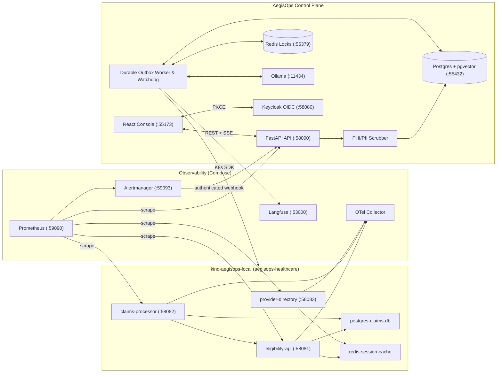

# AegisOps Architecture

> **Status:** Phases 0–5 implemented and verified end-to-end (`kind-aegisops-local`, CMDB + privacy scrubber, Hybrid RAG + Ollama refusal gate, Terraform RBAC, Redis leases, K8s Python SDK executor, 60s sustained watchdog, Keycloak OIDC PKCE + TOTP console, Langfuse traces, and 4 live chaos scenarios).

## 1. System Boundaries & Isolation
- **Control-Plane Storage** (`aegisops-postgres` on `127.0.0.1:55432`, `aegisops-redis` on `127.0.0.1:56379`): Isolated on Docker Compose network; never targeted by chaos scenarios. (`01-init.sql` also bootstraps isolated `aegisops_langfuse` database.)
- **Target Cluster** (`kind-aegisops-local`): Runs `aegisops-healthcare` namespace (`eligibility-api`, `claims-processor`, `provider-directory`, `postgres-claims-db`, `redis-session-cache`) and `aegisops-system` (`kube-state-metrics`).
- **Observability Plane**: OTel Collector (`55317/55318`), Prometheus (`59090`), Alertmanager (`59093`), Langfuse (`53000`), `kube-state-metrics` (`58084`).
- **Identity Plane**: Keycloak `26.0` (`58080`, realm `aegisops`, S256 PKCE client `aegisops-console`).
- **Local AI Plane**: Ollama (`127.0.0.1:11434`, `nomic-embed-text:latest` 768-dim, `llama3.2:3b`).

## 2. Implemented Component & Data-Flow Diagram

