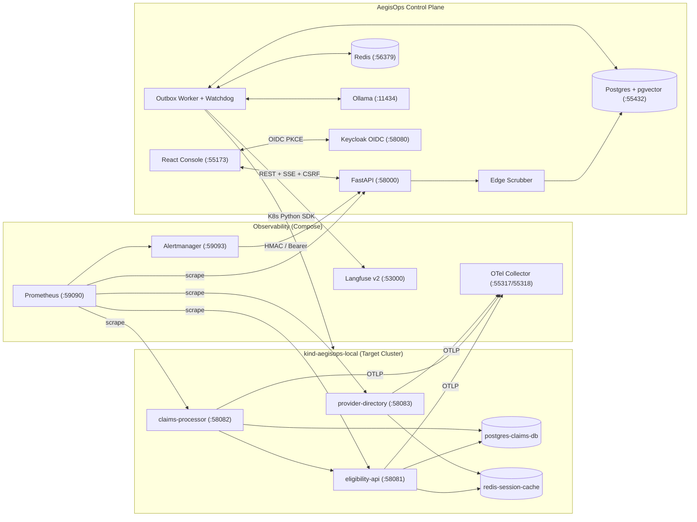
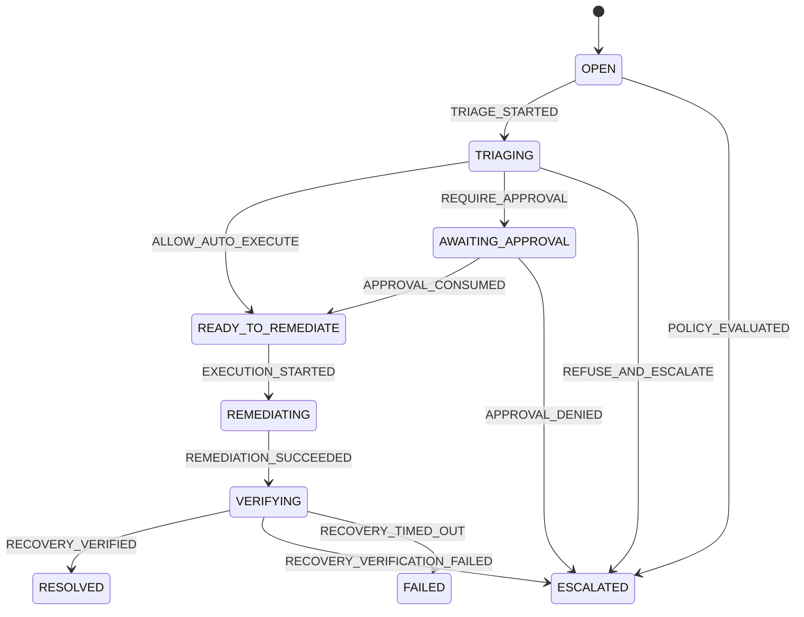

# AegisOps — Complete Technical & Operational Working Flow (`workingflow.md`)

> **Disclaimer & Scope Boundary:** AegisOps is an independent technical demonstration operating strictly on synthetic healthcare services inside a local workstation cluster (`kind-aegisops-local`). It implies no affiliation with Optum or any healthcare organization, no HIPAA/HITRUST regulatory certification, and no suitability for clinical production environments.

---

## 1. Application Purpose and Architecture

**AegisOps** is a locally runnable AIOps control plane, CMDB blast-radius analyzer, and self-healing Kubernetes operator for synthetic healthcare workloads (`eligibility-api`, `claims-processor`, and `provider-directory`). It serves two distinct audiences with strict separation between **presentation detail** (`Executive Overview` vs. `Technical Deep-Dive`) and **server-enforced authorization** (`visitor`, `viewer`, `operator`, `approver`).

### Runtime Services & Ports
- **Control Plane API (`backend/app/main.py`)**: FastAPI ASGI app on `127.0.0.1:58000` (proxies `/api`, `/healthz`, `/readyz` from Vite).
- **Durable Outbox Worker (`backend/app/worker/runner.py`)**: Standalone Python asyncio loop (`asyncio.Semaphore(4)`) consuming `outbox_jobs` via PostgreSQL `FOR UPDATE SKIP LOCKED`.
- **Frontend SRE Console (`frontend/`)**: React 18 + TypeScript + Vite 6 + `@xyflow/react` SPA on `127.0.0.1:55173`.
- **Backing Compose Stack (`infra/compose/docker-compose.yml`)**: PostgreSQL 16 + `pgvector` (`55432`), Redis 7.4 (`56379`), OpenTelemetry Collector (`55317/55318`), Prometheus (`59090`), Alertmanager (`59093`), Keycloak 26 OIDC (`58080`), Langfuse v2 (`53000`).
- **Local AI (`ollama serve`)**: Ollama on `127.0.0.1:11434` serving `nomic-embed-text:latest` (`768` dims) and `llama3.2:3b`.
- **Target Kubernetes Cluster (`kind-aegisops-local`)**: Terraform-scoped namespaces `aegisops-healthcare` (`eligibility-api:58081`, `claims-processor:58082`, `provider-directory:58083`, `postgres-claims-db`, `redis-session-cache`) and `aegisops-system` (`kube-state-metrics:58084`).

### Startup Sequence
`.\scripts\setup.ps1` -> `.\scripts\doctor.ps1` -> `.\scripts\up.ps1` -> `.\scripts\migrate.ps1` (`0001_initial_schema` -> `0002_showcase_upgrade`) -> `.\scripts\seed.ps1` (`8` CMDB assets, `9` edges, `18` runbooks/postmortems) -> FastAPI (`58000`) + Outbox Worker (`app.worker.runner`) + Vite (`55173`).



### Canonical State Machine & Replay Isolation


```mermaid
flowchart TB
    VIS["Visitor Mode / Replay Controller"] -->|GET /showcase/replays, /overview, /readiness, /evidence, /topology| API["FastAPI Read-Only Paths"]
    API -->|SELECT only| DB[("PostgreSQL Historical Events")]
    VIS -.->|Forbidden (401/403)| MUT["Chaos Launch, Probes, Upload, Approve, Baseline Reset"]
```

---

## 2. File and Code Map

Complete file-by-file ownership, symbols, APIs, and tests live in [docs/FILE_MAP.md](file:///d:/PROJECTS/AegisOps%20An%20Autonomous%20AIOps,%20CMDB%20Blast-Radius%20&%20Self-Healing%20Kubernetes%20Control/docs/FILE_MAP.md) and [docs/CODEMAP.md](file:///d:/PROJECTS/AegisOps%20An%20Autonomous%20AIOps,%20CMDB%20Blast-Radius%20&%20Self-Healing%20Kubernetes%20Control/docs/CODEMAP.md). Core architectural boundaries:
- **Backend Control Plane (`backend/app/`)**: `main.py`, `config.py`, `db.py`, `redis_client.py`, `models/entities.py`, `privacy/scrubber.py`, `cmdb/graph.py`, `domain/state_machine.py`, `playbooks/registry.py`, `rag/{embeddings,retriever,diagnosis}.py`, `policy/engine.py`, `k8s/executor.py`, `worker/{locks,watchdog,runner}.py`, `auth/{oidc,totp}.py`, `observability/{langfuse_tracer,ragas_eval}.py`.
- **Showcase Domain & APIs (`backend/app/showcase/`, `backend/app/api/`)**: `controls.py`, `scenarios.py`, `probes.py`, `replay.py`, `postmortem.py`, `pdf_renderer.py`, plus routers `webhooks.py`, `auth.py`, `approvals.py`, `incidents.py`, `topology.py`, `metrics.py`, `stream.py`, `runbooks.py`, and `showcase.py`.
- **Frontend Showcase Console (`frontend/src/`)**: `App.tsx`, `types.ts`, `lib/pkce.ts`, `styles.css`, and components `ChaosLabPanel.tsx`, `GuidedTourBar.tsx`, `LifecycleStepper.tsx`, `DecisionExplanationCard.tsx`, `BusinessProbeCard.tsx`, `PrivacyPromptDrawer.tsx`, `RunbookKnowledgePanel.tsx`, `ReplayController.tsx`, `EngineeringEvidenceView.tsx`, `TopologyGraph.tsx`, `IncidentDetail.tsx`, `MetricsDashboard.tsx`, `TotpModal.tsx`.

---

## 3. UI Navigation, Roles, and Presentation Modes

`frontend/src/App.tsx` checks `/api/v1/auth/me` on mount (after completing any S256 PKCE `code` exchange via `inFlightPkcePromise`).
- **Visitor Mode (`user == null`)**: Renders immediately with a prominent `"Visitor Mode (Read-Only)"` pill and `"Sign In with Keycloak OIDC (PKCE)"` action. Visitors navigate `Operations Console`, `Knowledge Base & Privacy Playground`, and `Engineering Evidence`, trigger Recorded Replay & Guided Tour fixtures, test the zero-persistence Privacy Scrubber Playground, run the Hybrid Search Tester, inspect live K8s topology facts (graph or Accessible Table View), and examine Engineering Evidence—with zero operational mutation authority.
- **View Toggle (`Executive Overview` vs `Technical Deep-Dive`)**: Switches visual disclosure of raw JSON diffs, RAG vector/RRF math, captured prompts, and user-configurable baseline inputs without changing server RBAC (`viewer`, `operator`, `approver`).
- **Real-Time Subscriptions & Queue Controls**: Authenticated sessions subscribe to `GET /api/v1/stream/incidents` (`EventSource`), track staleness (`> 20s` sets `(stale)` badge), and filter incidents across server-counted queue tabs (`Active`, `Resolved`, `Escalated`, `Failed`, `All`), `Hide Test Runs` (ON by default), search, and severity/time sorting.

---

## 4. Complete Autonomous Remediation Run (`traffic_spike` / `db_pool_freeze`)

1. **Trigger**: Operator clicks `Start Guided Demo` in `ChaosLabPanel.tsx` -> `POST /api/v1/showcase/scenarios/traffic_spike/launch`.
2. **Authorization & Exclusion (`backend/app/showcase/scenarios.py::launch_demo_scenario`)**: Requires `operator+` + CSRF, deduplicates `idempotency_key`, checks non-test `DemoRun`/`Incident` conflicts on `_conflicting_services` (returning HTTP `409` if held), captures baseline K8s snapshot, inserts `DemoRun(status="QUEUED")` + `OutboxJob(job_type="RUN_DEMO_SCENARIO")`, returns `202 Accepted`.
3. **Fault Execution (`execute_demo_scenario_job` in `scenarios.py`)**: Worker transitions `DemoRun` to `INJECTING_FAULT`, drives load / `/internal/fault` (`X-AegisOps-Fault-Token`) on `provider-directory`, updates `narration_state_json`, and waits for Prometheus/Alertmanager or signed self-webhook (`X-AegisOps-Provenance: interactive_demo`) to hit `POST /api/v1/webhooks/alertmanager`.
4. **Scrubbing, CMDB & Enqueue (`webhooks.py`)**: Validates HMAC/Bearer + rate limit + SSRF check, calls `scrub_alertmanager_payload`, runs `get_blast_radius` + `compute_severity` (`P3` on `provider-directory`, linking downstream `member-portal-gateway`), links active `DemoRun`, and inserts `Incident(OPEN)` + `IncidentEvent` + `AuditRecord` + `OutboxJob(TRIAGE_INCIDENT)` atomically.
5. **Triage & Policy (`runner.py::_handle_triage_job`)**: Embeds summary via Ollama (`nomic-embed-text:latest`), runs `hybrid_search_runbooks` (`RB-003`), invokes Ollama `llama3.2:3b` (`generate_diagnosis_with_record`, storing exact sanitized prompt on `Incident.sanitized_prompt_json`), records scrubbed Langfuse trace, and runs `evaluate_remediation_policy`. Since `replica_scale_out_bounded` is `LOW` risk and cosine similarity passes, policy returns `ALLOW_AUTO_EXECUTE`, moving `TRIAGING -> READY_TO_REMEDIATE` and enqueuing `EXECUTE_REMEDIATION`.
6. **Lock, K8s Mutation & 60s Watchdog (`runner.py`, `executor.py`, `watchdog.py`)**: Worker checks `system_control_flags` (`automation_paused`), acquires single-instance `RedisTargetLease` (`SET NX PX`), records `ExecutionAttempt`, scales `provider-directory` (`1 -> 3`), waits for rollout generation readiness, enters `VERIFYING`, and invokes `verify_sustained_recovery` updating `verification_state_json` every `5s` (`"Checking service stability: X of 60 seconds observed"`). Once 60 unbroken healthy seconds pass, worker runs post-recovery `execute_business_probe`, transitions `VERIFYING -> RESOLVED`, marks `DemoRun` `COMPLETED`, and updates Guided Tour narration.

---

## 5. Complete High-Risk Approval Run (`oom_memory_crash` / `bad_canary_update`)

1. **Detection & Policy Gating**: After injecting HTTP 500 canary `v1.9.0-broken` (`bad_canary_update`) or 210Mi memory pressure (`oom_memory_crash`), triage matches `RB-004`/`PM-003` or `RB-001`.
2. **Untrusted Override & Pending Lock**: `evaluate_remediation_policy` overrides any LLM image string unconditionally with server CMDB `Asset.known_good_image` (`aegisops/eligibility-api:v1.0.0-good`) or bounds memory strictly within `[128Mi, 512Mi]` (`384Mi`). Because `risk_tier == "HIGH"`, policy returns `REQUIRE_APPROVAL`, reads live K8s `uid` & `resource_version`, creates `ApprovalRequest(status="PENDING")` with SHA-256 `parameters_hash`, and enters `AWAITING_APPROVAL`.
3. **Action-Bound TOTP MFA (`backend/app/api/approvals.py::approve_high_risk_action`)**: Only Keycloak `approver` users with enrolled Fernet-decrypted `UserTotpSecret` can submit `POST /api/v1/incidents/{id}/approve`. Backend verifies CSRF, checks OTP via `verify_and_consume_totp` (`valid_window=1`, atomic `last_used_timecode` anti-replay + lockout counters), locks rows with `SELECT ... FOR UPDATE`, re-fetches live K8s `uid`/`resource_version` to abort on drift (`409 Conflict`), marks approval `CONSUMED`, moves `AWAITING_APPROVAL -> READY_TO_REMEDIATE`, and enqueues `EXECUTE_REMEDIATION`.
4. **Execution & Observed Verification**: Worker patches Kubernetes, confirms rollout completion, runs 60s Watchdog + business probe, and resolves cleanly.

---

## 6. Escalation & Refusal Run (`pii_leak_and_db_failure`)

1. Scenario 5 applies Kubernetes annotation `aegisops.io/simulated-fault=ERR_PG_REPLICATION_LAG` to demo `postgres-claims-db` in `aegisops-healthcare` (never touching control-plane Postgres `55432`), runs a failing DB business probe, and dispatches a signed alert containing fictional SSN, Member ID, Email, DOB, and Bearer tokens.
2. `scrub_alertmanager_payload` strips every sensitive token in memory before any log, DB row, embedding, Ollama prompt, or Langfuse trace, recording exact counts in `redaction_stats_json`.
3. Triage matches `RB-011` (`permitted_playbook_id=None`, `stateless_eligible=False`). Policy deterministically returns `REFUSE_AND_ESCALATE`, storing full P1 CMDB blast radius (`eligibility-api`, `claims-processor`, `member-portal-gateway`, `pharmacy-prior-auth`, `edi-837-ingest`) and transitioning directly to `ESCALATED` without mutating pods. `compute_lifecycle_steps` and `.md`/`.pdf` postmortems explicitly report Human Escalation and never green-wash the outcome.

---

## 7. Scenario Catalog

| Scenario ID | Target & Baseline | Fault Mechanism | Expected Signals | Policy & Playbook | Recovery & Cleanup |
|---|---|---|---|---|---|
| `traffic_spike` | `provider-directory` (`1` replica, `256Mi`) | Concurrent HTTP burst triggering `Semaphore(2)` delay | `ProviderDirectoryHighLatencyCpu`, `p95 > 0.5s` | `ALLOW_AUTO_EXECUTE` -> `replica_scale_out_bounded` (`1->3`) | 60s Watchdog + clinic search probe; reset restores `1` replica |
| `db_pool_freeze` | `eligibility-api` (`1` replica, `v1.0.0-good`) | `POST /internal/fault` saturates synthetic DB pool | `EligibilityDbPoolExhausted`, `ERR_PG_POOL_TIMEOUT_57P03`, 503 | `ALLOW_AUTO_EXECUTE` -> `stateless_deployment_restart` | 60s Watchdog + eligibility probe `PASS`; reset clears flags |
| `bad_canary_update` | `eligibility-api` (`v1.0.0-good`) | Patches deployment container to broken canary / 5xx fault | `High5xxErrorRate`, `ERR_CANARY_IMG_SHA_BAD_9921`, 500 | `REQUIRE_APPROVAL` (`approver` TOTP) -> `deployment_image_rollback` | K8s rolls back to `known_good_image`, 60s Watchdog |
| `oom_memory_crash` | `claims-processor` (`192Mi` limit, `1` replica) | `POST /internal/fault working_set_mb=210` | `ClaimsProcessorMemoryPressure`, `ERR_OOM_EXIT_137_CLAIMS_BATCH` | `REQUIRE_APPROVAL` (`approver` TOTP) -> `memory_limit_increase_bounded` (`384Mi`) | K8s patches container `384Mi`, 60s Watchdog + `/claims/adjudicate` |
| `pii_leak_and_db_failure` | `postgres-claims-db` (`stateless_eligible=False`) | K8s fault annotation + synthetic PII webhook | `PostgresReplicationLagHigh`, `ERR_PG_REPLICATION_LAG`, Redacted tokens | `REFUSE_AND_ESCALATE` (`RB-011` boundary) -> `ESCALATED` | Zero K8s mutation; reset clears DB annotation cleanly |

---

## 8. Canonical Data and Event Model

Alembic revisions `backend/migrations/versions/0001_initial_schema.py` and `0002_showcase_upgrade.py` manage `13` tables in `backend/app/models/entities.py` (`assets`, `asset_dependencies`, `incidents`, `incident_events`, `runbooks`, `approval_requests`, `execution_attempts`, `audit_records`, `outbox_jobs`, `user_totp_secrets`, `demo_runs`, `business_probe_samples`, `system_control_flags`):
- **Event Sequencing & Reconnect**: `incident_events.sequence_num` (`BIGINT IDENTITY`) drives `GET /api/v1/stream/incidents` (`after_seq` / `Last-Event-ID`). Append-only PostgreSQL triggers block `UPDATE`/`DELETE` on `incident_events` and `audit_records`.
- **Trusted Provenance**: `incidents.source_provenance` (`live_alert`, `interactive_demo`, `automated_test`, `recorded_replay`, `unknown`) is set server-side via verified webhook headers/active `DemoRun` correlation and defaults UI queue `Hide Test Runs` to exclude `automated_test`.
- **Prompt & Watchdog Snapshots**: `incidents.sanitized_prompt_json` stores the redacted LLM payload at call time; `incidents.verification_state_json` captures per-tick elapsed/target/reset progress.

---

## 9. Complete API Contract

All live FastAPI routes, roles, handlers, and responses are documented in [docs/API.md](file:///d:/PROJECTS/AegisOps%20An%20Autonomous%20AIOps,%20CMDB%20Blast-Radius%20&%20Self-Healing%20Kubernetes%20Control/docs/API.md) across `webhooks.py`, `auth.py`, `approvals.py`, `incidents.py`, `topology.py`, `metrics.py`, `stream.py`, `runbooks.py`, and `showcase.py`.

---

## 10. Incident Lifecycle and Sustained Watchdog Countdown

`backend/app/api/incidents.py::compute_lifecycle_steps` derives 7 steps strictly from persisted `Incident`, `IncidentEvent`, `ApprovalRequest`, and `ExecutionAttempt` records:
1. Alert caught -> 2. Sensitive data checked & scrubbed -> 3. Service impact mapped -> 4. Runbooks retrieved & AI diagnosis -> 5. Policy decision & execution -> 6. Recovery verification -> 7. Outcome (`Verified resolution`, `Human escalation`, or `Failed`).
- During Step 6 (`VERIFYING`), `verify_sustained_recovery` (`backend/app/worker/watchdog.py`) polls Kubernetes Deployment readiness, pod HTTP `/readyz`, HTTP traffic coverage (`rate(http_requests_total[30s])`), and PromQL SLOs every `5s` (`AEGISOPS_RECOVERY_POLL_INTERVAL_SECONDS`), persisting `elapsed_healthy_seconds`, `window_seconds` (`AEGISOPS_RECOVERY_WINDOW_SECONDS`, default `60`), `reset_count`, and `last_reset_reason`. Any probe dip or missing telemetry resets the elapsed counter (`reset_count += 1`) before final `RESOLVED` transition is allowed. `ESCALATED` and `FAILED` terminal outcomes never render Step 7 as green `Verified resolution`.

---

## 11. Privacy Scrubbing and Capture of Model Prompts

- **Ingestion & Playground (`backend/app/privacy/scrubber.py`, `POST /api/v1/showcase/privacy/preview`)**: Both production webhooks (`scrub_alertmanager_payload`) and the public playground (`scrub_text`) run deterministic patterns for dashed/contextual SSNs, synthetic healthcare IDs (`MBR-`/`MBI-`/`MRN-`), emails, US phone numbers, DOBs, labeled names, Bearer tokens, JWTs, and IPv4 addresses, plus webhook field allowlisting (`ALLOWED_ALERT_LABELS`). Playground requests enforce `<= 8 KiB` (`413`), Redis sliding-window rate limit `30/60s` (`429`), zero logging, and zero database persistence. Known regex boundaries (such as unlabeled free-form names) are displayed alongside results.
- **Exact Model Prompt Capture (`diagnosis.py::generate_diagnosis_with_record`, `GET /api/v1/incidents/{id}/prompt`)**: Wraps post-scrub telemetry and retrieved runbooks inside XML fences (`<untrusted_telemetry>`, `<retrieved_runbook_data>`) before invoking `llama3.2:3b` (`temperature=0`, JSON schema), persists the exact system/user prompts and metadata on `incidents.sanitized_prompt_json`, and returns an explicit uncaptured notice (`captured: False`) on historical rows lacking it.

---

## 12. Knowledge Browser, Markdown Upload, and Hybrid RAG Search

- **Validated Markdown Upload (`backend/app/api/runbooks.py::upload_runbook_markdown`)**: Requires `operator+` + CSRF, `.md` extension, `<= 64 KiB` UTF-8 text, rejects `<script>`/`javascript:`/`on*=` attributes and path traversal, parses YAML frontmatter, rejects overwriting built-in `seeded_file` docs (`409`), enforces `version` progression, and rejects unknown `permitted_playbook_id` values or `risk_tier` downgrades (`400`). Records transition `UPLOADED -> VALIDATING -> INDEXING -> READY/FAILED`.
- **Hybrid Search & Threshold Explanation (`backend/app/rag/retriever.py`, `POST /api/v1/runbooks/search`)**: Filters strictly `indexing_status = 'READY' AND embedding IS NOT NULL`. Fuses PostgreSQL `websearch_to_tsquery` + `ts_rank_cd` (GIN) with `1 - cosine_distance` (`pgvector` HNSW `768`d `nomic-embed-text:latest`) via Reciprocal Rank Fusion (`k=60`). Displays vector cosine similarity separately from RRF rank score (`0.78` `AEGISOPS_SIMILARITY_THRESHOLD` or lexical corroboration `>= 0.05` + `cosine >= 0.50`) and surfaces empty, ambiguous, indexing-in-progress, or unavailable-model (`503`) states explicitly.

---

## 13. Policy Decision, Execution Concurrency, and "Why This Action?"

`backend/app/api/incidents.py::build_why_this_action` powers `DecisionExplanationCard.tsx`, separating untrusted LLM diagnosis (`ai_recommendation_hypothesis`), deterministic server authorization (`policy_authorization`, `PLAYBOOK_REGISTRY` in `backend/app/playbooks/registry.py`), step-up TOTP enforcement (`approvals.py`), and Kubernetes execution/recovery (`executor.py`). Execution concurrency is protected by Redis Lua `RedisTargetLease`, pre-mutation `ExecutionAttempt` rows, and `reconcile_or_execute` rollover generation checks.

---

## 14. Topology Live Kubernetes Facts and Business Probes

- **Live Topology (`backend/app/api/topology.py`, `TopologyGraph.tsx`)**: Fetches deployment facts via read-only impersonated `KubernetesExecutor.read_deployment_snapshot` using a 3s TTL cache (returning explicit `stale` / `unavailable` markers if Kubernetes reads fail). Displays `"X ready / Y desired"`, container image tag, container name, memory limit, rollout status, before/after diff badges for selected incidents, and an Accessible Table View alternative.
- **Business Transaction Probes (`backend/app/showcase/probes.py`, `BusinessProbeCard.tsx`)**: Restricts probes strictly to 4 allowlisted demo services (`eligibility-api` `POST /api/eligibility/check`, `claims-processor` `POST /claims/adjudicate`, `provider-directory` `GET /providers/search`, and `postgres-claims-db` health + eligibility semantics). Verifies JSON transaction fields alongside latency and persists bounded sanitized history in `business_probe_samples`.

---

## 15. Recorded Incident Replay and Unified Postmortem Exports

- **Recorded Replay (`backend/app/showcase/replay.py`, `ReplayController.tsx`)**: Strictly read-only `GET /api/v1/showcase/replays{,/{id}}`, labeling PostgreSQL cluster timelines as `"Captured from local cluster run"` vs curated sample fixtures `"Illustrative fixture (synthetic timeline)"`. Frame scrubbing reconstructs historical execution diffs and watchdog snapshots up to that timestamp without bleeding current cluster pod counts back into early frames and triggers zero DB/Redis/K8s writes.
- **Unified `.md` and `.pdf` Postmortems (`postmortem.py`, `pdf_renderer.py`, `incidents.py`)**: Both formats consume one server-side `PostmortemSnapshot` (`viewer+` auth, `Cache-Control: no-store`). Escapes untrusted Markdown/HTML, labels `ESCALATED`/`FAILED`/`manual_reset_assisted` honestly, strips TOTP seeds/codes/tokens, and generates standards-compliant zlib-compressed `%PDF-1.4` multi-page documents using Type1 Helvetica/Courier fonts without external asset fetching.

---

## 16. Measured Metrics, Baseline Treatment, and Engineering Evidence

- **Honest Value & Latency Metrics (`backend/app/api/metrics.py`)**: Scoped via `scope=live_and_demo | automated_test | all`. Computes MTTD, triage latency, action latency, 60s verification window, and end-to-end MTTR (`mean`, `p50`, `p95`, `min`, `max`, `sample_count`, `mttd_unavailable_count`). Reports redacted token counts (`sensitive_identifiers_redacted`) explicitly as token matches (not distinct patients) and defaults manual comparison to `"Baseline not configured"` unless the user supplies `manual_baseline_minutes` (`source: "user_supplied_assumption"`).
- **Engineering Evidence (`GET /api/v1/showcase/evidence`, `EngineeringEvidenceView.tsx`)**: Serves live git commit/branch, Python/App/Alembic `0002` revision, Ollama model/threshold settings, explicit trust limits, Ragas/k6 artifacts (`docs/evidence/{ragas-evaluation,k6-summary}.json`), and latest verification logs.

---

## 17. Readiness, Reliable Baseline Reset, and Operator Controls

`backend/app/showcase/controls.py` implements:
- **`collect_system_readiness`**: Evaluates Postgres/pgvector, Redis, Worker heartbeat (`aegisops:worker:heartbeat:*`), Knowledge Base `READY` count, Ollama models, Prometheus, Keycloak JWKS, and all demo Kubernetes deployments, computing `Ready` / `Degraded` / `Blocked` globally and per scenario.
- **`set_automation_flag`**: Backend-enforced `automation_paused` switch causing `_handle_execute_job` in `runner.py` to record `AUTOMATION_PAUSED_HOLD` and requeue pending mutations without aborting in-flight HTTP calls or rolling back prior patches.
- **`preview_demo_baseline_reset` & `execute_demo_baseline_reset`**: Previews exact deployment diffs scoped solely to `aegisops-healthcare`, restores healthy replicas/images/`192Mi` limit/fault flags idempotently, preserves `audit_records`/`incidents`/uploaded runbooks, and labels any force-closed open incidents `manual_reset_assisted`.

---

## 18. Setup, Operations, and Quickstart Commands

- **Bootstrap**: `.\scripts\setup.ps1` -> `.\scripts\doctor.ps1` -> `.\scripts\up.ps1` -> `.\scripts\migrate.ps1` -> `.\scripts\seed.ps1`.
- **Run Daemons**: FastAPI (`.\.venv\Scripts\uvicorn.exe app.main:get_app --factory --host 127.0.0.1 --port 58000`), Outbox Worker (`.\.venv\Scripts\python.exe -m app.worker.runner`), Vite Console (`npm --prefix frontend run dev` at `http://127.0.0.1:55173`).
- **Run Verification Gate**: Stop standalone worker daemon temporarily, run `.\scripts\test.ps1`, restart worker daemon, run `.\.venv\Scripts\python.exe scripts/verify_docs.py`.
- **Environment Keys**: Documented completely in `.env.example` and `backend/app/config.py` (`AEGISOPS_*`, `KEYCLOAK_*`, `LANGFUSE_*`, `DEMO_INTERNAL_FAULT_TOKEN`, `POSTGRES_*`, `REDIS_PORT`).

---

## 19. Verification Results, Limitations, and Honest Boundaries

- **Final Showcase Gate (`.\scripts\test.ps1` -> `docs/evidence/showcase-test-gate.txt`, `2026-11-17T11:18+05:30`)**:
  - **Ruff & Mypy**: `All checks passed!`; `Success: no issues found in 50 source files`.
  - **Pytest**: `65 passed in 220.05s` (`0` failed, `0` skipped) across pure unit suites, live Postgres/Redis/Ollama/Keycloak/`kind` integration suites, mocked failure checks, and headless Chromium Playwright E2E (`test_browser_console.py` + `test_showcase_browser.py`).
  - **Frontend Build**: `tsc -b && vite build` (`68` modules in `5.06s`).
- **Explicit Boundaries & Limitations**:
  - Hosted GitHub Actions workflows (`.github/workflows/ci.yml`, `.github/workflows/live-cluster-chaos.yml`) and destructive `scripts/reset.ps1 -Force` were not executed on this verified local cluster.
  - Database failover (`postgres-claims-db`) is unsupported (`RB-011`) and always escalates.
  - Synthetic corpus redaction scores (`precision=1.0`, `recall=1.0`) and local Ragas scores (`faithfulness=0.7083`, `context_recall=0.8586`, `2/5` `NaN` on 3B NLI) reflect synthetic local evaluation and imply neither HIPAA certification nor clinical suitability.
